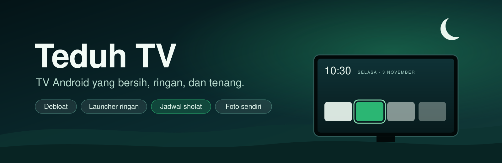
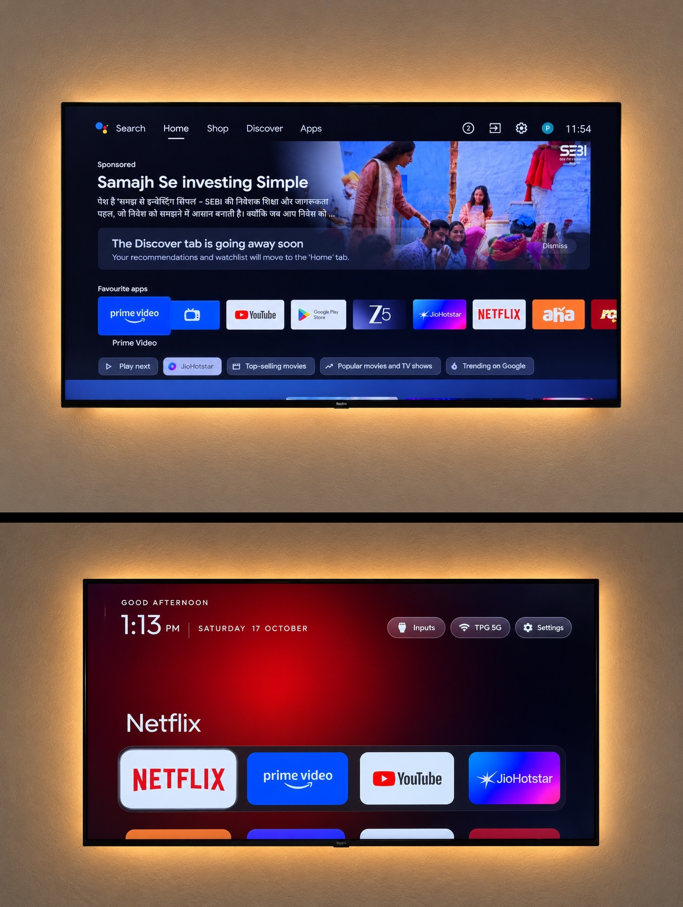
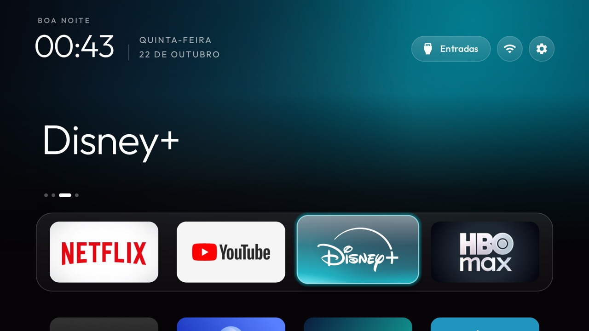
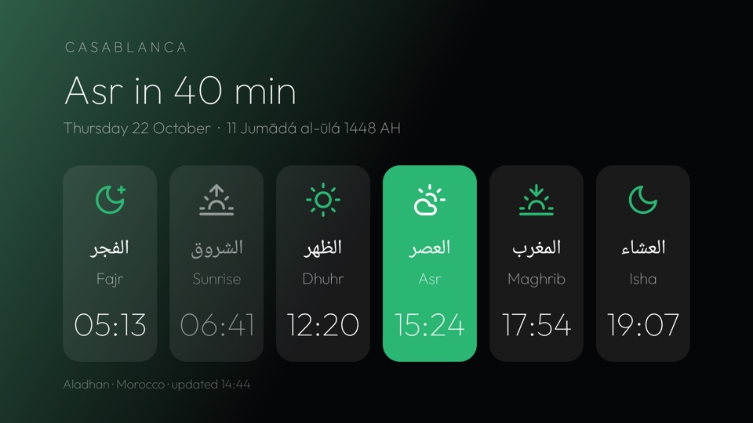
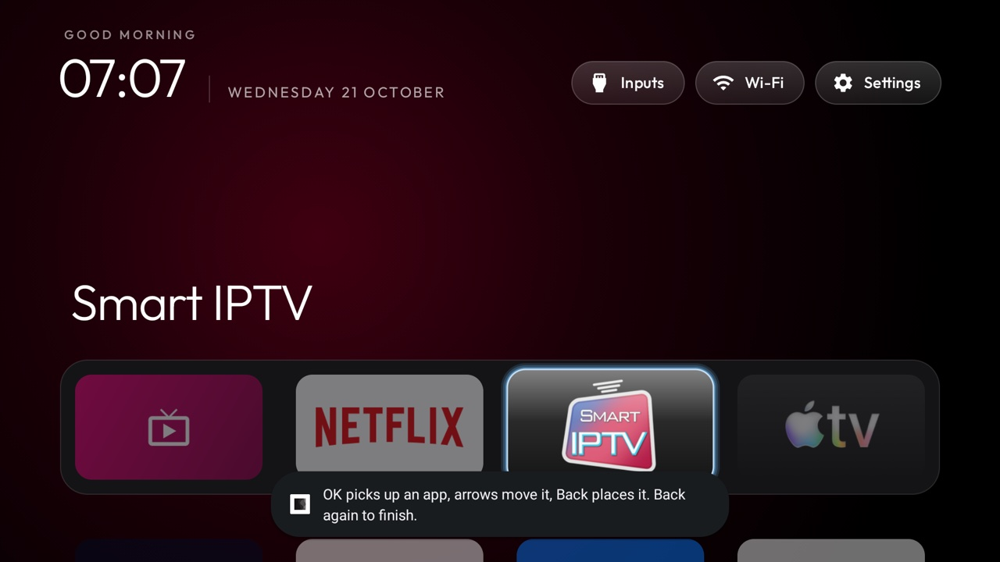
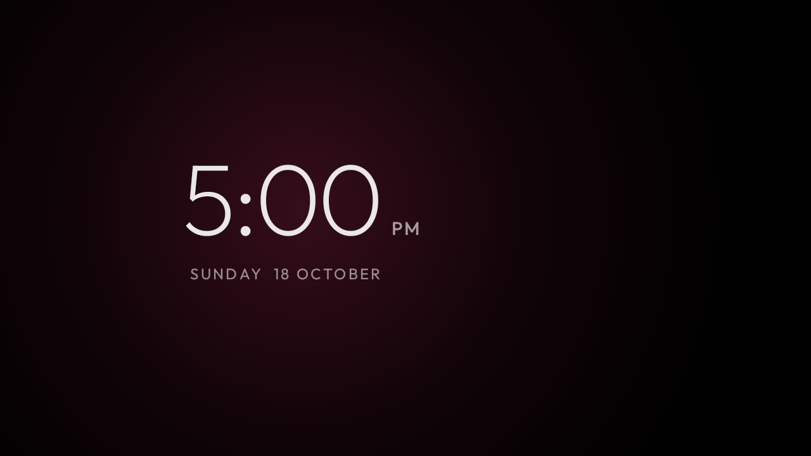
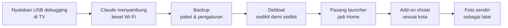

  

  
  
  
  

**Teduh TV** membersihkan bloatware dari Android TV atau Google TV lewat Wi-Fi, mengganti home screen
yang penuh iklan dengan launcher yang tenang, menampilkan jadwal sholat versi Kemenag RI, dan memutar foto
pilihan Anda sendiri sebagai latar.

Tanpa root, tanpa kabel, tidak ada yang di-uninstall, dan semuanya bisa dikembalikan seperti semula.

## Sebelum dan sesudah

  

Atas: home screen bawaan, penuh iklan dan rekomendasi. Bawah: launcher yang sama dengan yang dipakai Teduh. 
Foto dari proyek <a href="https://github.com/Gathin23/cleanyourtv">CleanYourTV</a>, di TV Redmi.

## Kenapa Teduh

| | |
|---|---|
| 🪶 **Ringan** | Launcher di bawah 576 KB, dibuat untuk TV dengan RAM 1 GB. Tanpa iklan, tanpa pelacakan, tanpa layanan latar. |
| 📴 **Offline** | Launcher sama sekali tidak punya izin internet. Hanya add-on sholat yang mengambil jadwal hari ini dari [Aladhan](https://aladhan.com/), cukup kota dan tanggal, tanpa akun. |
| 🛟 **Aman** | Aplikasi bawaan hanya **dinonaktifkan** (`pm disable-user`), tidak pernah dihapus. Ada backup sebelum perubahan dan skrip restore untuk mengembalikan semuanya. |
| ✅ **Teruji** | Lebih dari 400 daftar debloat yang sudah dicoba di TV sungguhan. Daftarnya ada di [examples/README.md](examples/README.md). |

## Tampilannya

| | |
|---|---|
|  |  |
| **Home dengan tema glass.** Jam dan sapaan, tombol Input HDMI, Wi-Fi dan Pengaturan, dock kaca. Bahasa mengikuti bahasa TV. | **Waktu sholat.** Lima waktu plus terbit, hitung mundur ke sholat berikutnya, tanggal Masehi dan Hijriah. *(Contoh dengan kota Casablanca; di Teduh default-nya Jakarta, metode Kemenag.)* |
|  |  |
| **Atur dari remote.** Pilih aplikasi, tahan OK lalu pilih Move; aplikasi dipindah dengan tombol panah. | **Screensaver jam.** Jam bergeser pelan supaya layar tidak terbakar (burn-in). |

Tangkapan layar diambil dari TV sungguhan oleh proyek CleanYourTV, dengan launcher yang sama dengan Teduh. Foto Anda sendiri menggantikan latar gelapnya.

## Fitur

| Fitur | Keterangan |
|---|---|
| **Debloat** | Mematikan telemetri, layanan iklan, baris konten berbayar, dan aplikasi bawaan yang tidak dipakai. Aplikasi yang dipakai keluarga (YouTube, Netflix, Vidio, Chromecast, asisten suara) ditanyakan dulu. |
| **Launcher** | Dock berisi aplikasi favorit, grid aplikasi, tombol Input HDMI, Wi-Fi, Pengaturan, jam, dan screensaver jam. Tombol remote tetap berfungsi. |
| **Waktu sholat** | Add-on [`addons/prayer-times`](addons/prayer-times/): metode **Kemenag RI** (Subuh 20°, Isya 18°), mazhab Syafi'i, untuk kota mana pun di Indonesia (WIB, WITA, WIT). Jadwal hari ini dan hitung mundur ke sholat berikutnya tampil langsung di Home, di kanan atas, tanpa membuka aplikasi. Bisa ditambah pengingat saat masuk waktu. |
| **Foto sendiri** | Foto keluarga atau pemandangan diputar bergantian sebagai latar Home. Foto besar dari HP dikecilkan otomatis oleh launcher. Foto tetap di TV dan di komputer Anda, tidak masuk repo. Dengan add-on [`addons/photos`](addons/photos/) (Foto Latar), foto bisa ditambah dari HP lewat kode QR, dipilih atau dihapus pakai remote, tanpa laptop. |

## TV yang didukung

| TV atau box Anda | Hasilnya |
|---|---|
| **Android TV atau Google TV, Android 8 ke atas** (Sony, TCL, Xiaomi, Philips, Sharp, Chromecast with Google TV, Mi Box, dan lainnya; yang menentukan sistem operasinya, bukan mereknya) | Semua fitur |
| **Android TV 5–7** | Debloat saja: launcher butuh Android 8 |
| **Fire TV** | Debloat saja: Fire OS selalu merebut kembali tombol Home |
| **Samsung (Tizen), LG (webOS), Hisense VIDAA, Roku** | Tidak bisa, karena tidak ada ADB. Pasang Google TV stick di port HDMI-nya untuk mendapatkan semua fitur. |

## Cara pasang (pakai Claude)

| Langkah | Yang dilakukan |
|---|---|
| **1. Di TV** | Pengaturan → Preferensi Perangkat → Tentang → tekan OK di **Build** tujuh kali → kembali → Opsi pengembang → **USB debugging** aktif (dan **Network/ADB debugging** kalau ada). Biarkan TV menyala. |
| **2. Di komputer** | Clone repo ini, `git clone https://github.com/eexvuu/teduh-tv`, lalu buka foldernya di Claude Code dan ketik: *"pasang Teduh TV di TV saya"*. Claude membaca [AGENTS.md](AGENTS.md) dan menjalankan prosedur aman di [PROMPT.md](PROMPT.md). |
| **3. Ikuti saja** | Terima "Izinkan USB debugging?" di TV (centang **Selalu izinkan**), lalu jawab pertanyaan Claude: aplikasi apa yang dipakai, urutan dock, kota untuk jadwal sholat, dan foto mana yang mau dipasang. |

Clone dulu supaya Claude memakai skrip yang sudah teruji di repo ini, `tools/disable.sh` dan
`launcher/build-and-install.sh` (lengkap dengan pengaman Home dan backup), bukan menulis skrip sendiri.
Yang perlu ada di komputer: Python 3, JDK 17 (lengkap, bukan JRE) dan Android SDK platform 34 dengan
build-tools 34.0.0. Kalau belum ada, Claude akan bilang dulu apa yang perlu diunduh dan meminta izin Anda.

## Mencoba tanpa TV

Launcher dan add-on sholat bisa dicoba di laptop dengan **emulator Android TV** dari Android SDK (paket
`emulator` dan system image Android TV, sekitar 1,5 GB, butuh virtualisasi aktif di BIOS). Di emulator
Anda bisa melihat Home, kartu sholat, dan tema foto. Debloat tetap harus dicoba di TV sungguhan, karena
emulator tidak membawa aplikasi bawaan pabrik.

## Mengembalikan TV

Semua perubahan dicatat sebelum dilakukan. `tools/restore.sh` (Windows: `tools\restore.ps1`) menyalakan
lagi semua yang dinonaktifkan dan mengembalikan launcher bawaan. Tanpa komputer pun, menu
Pengaturan → Aplikasi di TV bisa menyalakan kembali aplikasinya. Detailnya ada di [docs/restore.md](docs/restore.md).

## Isi repo

| Folder | Isinya |
|---|---|
| [`AGENTS.md`](AGENTS.md) | Panduan untuk Claude: urutan pemasangan dan aturan keselamatannya. |
| [`launcher/`](launcher/) | Launcher (Java, `minSdk` 26). |
| [`addons/prayer-times/`](addons/prayer-times/) | Add-on waktu sholat. |
| [`addons/photos/`](addons/photos/) | Add-on Foto Latar: kelola foto latar dari TV dan HP. |
| [`examples/`](examples/) | Daftar debloat per model TV. |
| [`themes/`](themes/) | Tema: warna, dock, wallpaper. Panduan kuncinya ada di [`themes/README.md`](themes/README.md). |
| [`tools/`](tools/) | Klien ADB (`tv.py`) dan skrip debloat, restore, dan tema. |
| [`docs/`](docs/) | Panduan teknis lengkap ([docs/GUIDE.md](docs/GUIDE.md), dalam bahasa Inggris), troubleshooting, catatan per perangkat. |

Mau berkontribusi? Baca [CONTRIBUTING.md](CONTRIBUTING.md).

## Kredit dan lisensi

Teduh TV dibangun dari **[CleanYourTV](https://github.com/Gathin23/cleanyourtv) karya Gathin** dan para
kontributornya (versi 3.3, commit `d7b0d4a`), berlisensi MIT. Tangkapan layar di halaman ini juga dari
proyek tersebut. Add-on waktu sholat aslinya dibuat oleh [majnioui](https://github.com/majnioui). Ide
fitur lokal terinspirasi dari [Glass TV](https://github.com/aqmangge/glass-tv-home). Font Outfit memakai
SIL Open Font License.

Lisensi: [MIT](LICENSE). Teduh TV tidak berafiliasi dengan Google, produsen TV mana pun, atau Kemenag RI.
