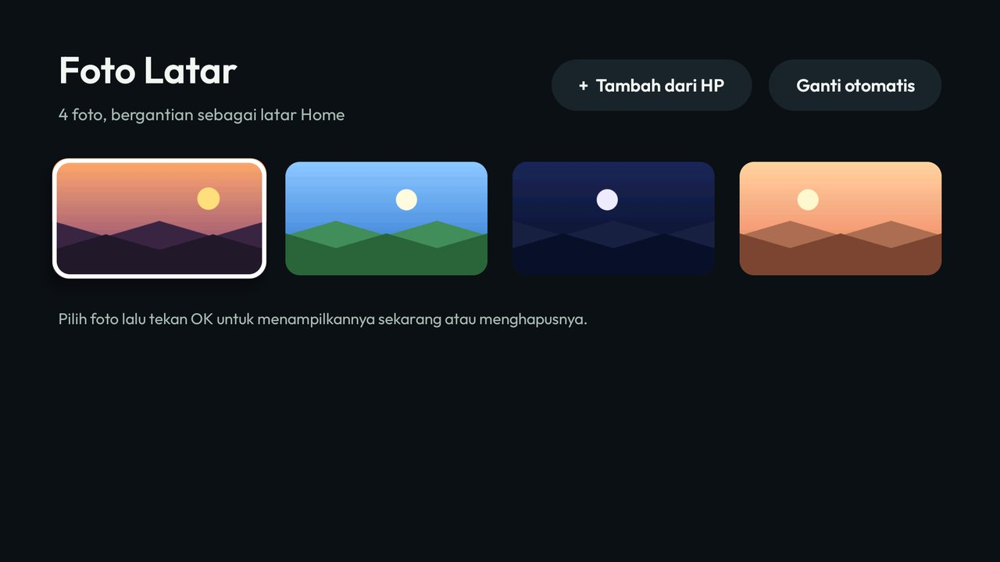

# Foto Latar

Kelola foto latar Home Teduh TV langsung dari TV: tambah dari HP lewat kode QR, tampilkan satu foto sekarang,
hapus foto, atau kembali ke pergantian otomatis. Untuk launcher Teduh TV ia memasang [kartu modul](../../docs/modules.md):
setelah Anda menjawab **Tampilkan kartu**, ubinnya bertuliskan "Foto Latar · Tambah dari HP" dengan cahaya biru.



- **Tambah dari HP**: TV menampilkan kode QR dan alamatnya (`ip:port/kode`). HP di Wi-Fi yang sama memindainya,
  memilih satu atau beberapa foto, dan tiap foto langsung muncul di galeri. Kodenya acak 6 angka, baru setiap
  layar dibuka, dan penerimaan berhenti begitu layar ditutup. Paling banyak 100 foto, 40 MB per foto.
- **Foto disiapkan di TV**: diputar sesuai EXIF (foto HP tidak miring), lalu diperkecil hingga pas menutupi
  1920×1080 (tidak pernah diperbesar) dan disimpan sebagai JPEG. Foto aslinya tidak disimpan.
- **OK pada foto**: "Tampilkan di Home sekarang" (foto itu tetap di Home) atau "Hapus dari TV" (dengan konfirmasi).
- **Ganti otomatis**: kembali bergantian di semua foto, mengikuti `wallpaper_rotation_minutes` tema.
- Foto disimpan oleh launcher sendiri (koleksi `wallpapers/` tema), jadi Home tidak perlu internet untuk menampilkannya.

> **Perhatian:** mengirim tema dari laptop (`tools/theme.sh` / `tools\theme.ps1`) mengganti seluruh koleksi foto
> di TV dengan foto tema itu. Foto yang dikirim dari HP ikut terhapus. Kirim tema tanpa folder `wallpapers/`
> kalau hanya ingin mengubah setelan, atau tambahkan lagi fotonya lewat Foto Latar.

## Pasang

Bangun dan pasang seperti add-on lain ([addons/README.md](../README.md)), lalu beri izin sekali lewat ADB:

```bash
TV_HOST=<tv ip> tools/venv/bin/python -I tools/tv.py 'pm grant id.teduh.photos android.permission.WRITE_SECURE_SETTINGS'
```

Tanpa izin itu aplikasi menampilkan perintah di atas alih-alih galeri. Taruh di dock dengan
`"dock_apps": [..., "id.teduh.photos", ...]` di `config.json` tema. Butuh launcher Teduh TV yang punya
`ThemeProvider` dengan query/update (versi ini); di launcher lama aplikasi memberi tahu bahwa launcher perlu diperbarui.

Diuji di emulator Android TV 14 (1080p). Belum diuji di TV sungguhan.

## Permissions

| Permission | Why |
|---|---|
| `INTERNET` | Hanya untuk halaman unggah lokal: server kecil di jaringan rumah selama layar "Tambah dari HP" terbuka. Tidak menghubungi internet. |
| `WRITE_SECURE_SETTINGS` | Diberikan lewat ADB (`pm grant`). Launcher hanya membuka koleksi fotonya (`content://com.gathin.tvhome.theme`) untuk pemegang izin ini. |

Itu saja. Tidak ada akun, telemetri, iklan, layanan latar, atau penjadwalan. Backup dimatikan.

## Kredit

Kode QR dibuat dengan [QR Code generator library](https://www.nayuki.io/page/qr-code-generator-library) oleh
Project Nayuki (`io.nayuki:qrcodegen`, MIT). Huruf Outfit (OFL, lihat `FONT-LICENSE-OFL.txt`).
